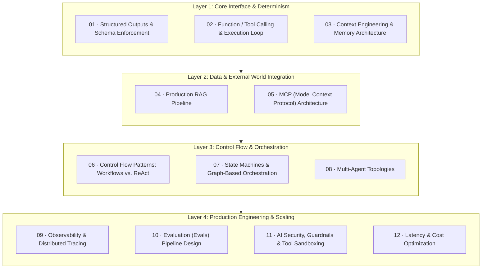

# AI Systems Engineering

A 12-part hands-on engineering series in Python focused on designing, building, and scaling **production-grade AI and agentic systems**.

Rather than treating Large Language Models as magic black boxes, this repository approaches AI from a **systems engineering** perspective—starting with making a single probabilistic model call deterministic, connecting it safely to external data and tools, orchestrating stateful multi-step workflows, and hardening the entire stack for real-world production traffic.

---

## Architecture Overview

The series is structured across **4 progressive architectural layers** and **12 deep-dive episodes**:



---

## 12-Part Series Roadmap

### Layer 1: Core Interface & Determinism
*Turning a single probabilistic LLM call into a reliable, predictable software component.*

1. **Structured Outputs & Schema Enforcement** (`01-structured-outputs-and-schema-enforcement/`)
   - Forcing probabilistic text generation into deterministic JSON schemas (constrained decoding)
   - Validation layers with Pydantic
   - Automated retry and fallback loops when schema validation fails

2. **Function / Tool Calling & Execution Loop** (`02-tool-calling-and-execution-loop/`)
   - Why LLMs never execute code directly—separating tool intent generation from execution
   - JSON Schema-based tool call generation and the backend execution loop
   - Feeding tool execution errors back to the model and enforcing strict timeouts

3. **Context Engineering & Memory Architecture** (`03-context-engineering-and-memory/`)
   - Context window budgeting and attention degradation as token count grows (*context rot*)
   - Short-term memory strategies: sliding window vs. iterative summarization
   - Long-term memory pipelines: episodic and semantic storage & retrieval flows

---

### Layer 2: Data & External World Integration
*Moving the model beyond a closed text engine and connecting it to external data sources and live services.*

4. **Production RAG Pipeline: Hybrid Search, Reranking & Query Transformation** (`04-production-rag-pipeline/`)
   - Document chunking strategies and the limitations of pure vector search
   - Combining lexical (BM25) + dense vector retrieval via Hybrid Search & Reciprocal Rank Fusion (RRF)
   - Cross-Encoder reranking and dynamic Query Rewriting when retrieval quality is insufficient

5. **MCP (Model Context Protocol) Architecture** (`05-mcp-architecture/`)
   - Solving the `N × M` tool-and-model integration problem
   - Host–Client–Server topology and transport layers (`stdio` vs. Streamable HTTP/SSE)
   - Managing context bloat when exposing large tool catalogs to a model

---

### Layer 3: Control Flow & Orchestration
*Transforming isolated calls into stateful, branching systems capable of multi-step reasoning and decision-making.*

6. **Control Flow Patterns: Deterministic Workflows vs. ReAct Loops** (`06-control-flow-patterns/`)
   - Architectural comparison of Prompt Chaining, Routing, Parallelization, and Evaluator-Optimizer workflows against autonomous ReAct (Reason + Act) loops
   - Engineering trade-offs across predictability, latency, and token cost

7. **State Machines & Graph-Based Orchestration** (`07-state-machine-and-graph-orchestration/`)
   - Modeling agent execution as a directed graph (nodes, edges, and shared state)
   - Fault-tolerant persistence and resumption via checkpointing
   - Human-in-the-Loop (HITL) interrupt points before high-stakes actions

8. **Multi-Agent Topologies** (`08-multi-agent-topologies/`)
   - Supervisor vs. Handoff multi-agent architectures
   - Inter-agent context isolation (preventing full conversation history leakage across agents)
   - Shared state management, `max_iterations` budgets, and infinite-loop prevention mechanisms

---

### Layer 4: Production Engineering & Scaling
*Making AI systems observable, testable, secure, and cost-effective under live production traffic.*

9. **Observability & Distributed Tracing** (`09-observability-and-distributed-tracing/`)
   - Debugging non-deterministic pipelines in production
   - Trace and Span hierarchies across multi-step LLM and tool calls
   - Per-step token accounting, TTFT (Time to First Token), and end-to-end latency breakdown

10. **Evaluation (Evals) Pipeline Design** (`10-evaluation-pipeline-design/`)
    - Building representative golden datasets
    - Deterministic assertions (schema compliance, latency SLAs, tool selection accuracy)
    - LLM-as-a-Judge evaluation architectures and automated CI/CD regression suites for prompt/model updates

11. **AI Security, Guardrails & Tool Sandboxing** (`11-ai-security-guardrails-and-sandboxing/`)
    - Input and output guardrail layers
    - Defending against direct and indirect prompt injection vectors
    - Principle of Least Privilege for tools (read vs. write separation) and sandboxed execution for code-running agents

12. **Latency & Cost Optimization** (`12-latency-and-cost-optimization/`)
    - Task-complexity Model Routing (small/fast models vs. frontier models)
    - Prompt Caching and Semantic Caching strategies
    - High-availability resilience against provider outages with Circuit Breakers and multi-provider Fallbacks

---

## Repository Structure

Each episode in the series is developed in its own dedicated subdirectory so you can study, run, and experiment with every topic independently:

```text
AI-Systems-Engineering/
├── 01-structured-outputs-and-schema-enforcement/
├── 02-tool-calling-and-execution-loop/
├── 03-context-engineering-and-memory/
├── 04-production-rag-pipeline/
├── 05-mcp-architecture/
├── 06-control-flow-patterns/
├── 07-state-machine-and-graph-orchestration/
├── 08-multi-agent-topologies/
├── 09-observability-and-distributed-tracing/
├── 10-evaluation-pipeline-design/
├── 11-ai-security-guardrails-and-sandboxing/
├── 12-latency-and-cost-optimization/
├── .env.example          # Template for API keys & observability endpoints
├── .gitignore            # Configured for Python, secrets, vector DBs & traces
├── requirements.txt      # Shared base Python dependencies
└── README.md
```

> **Note:** Episode directories are added progressively as each video in the series is published.

---

## Getting Started

### 1. Prerequisites
- **Python 3.10+**
- API key(s) for the LLM provider(s) used in the episode you are running (e.g., OpenAI, Anthropic, Google Gemini)

### 2. Clone & Set Up Virtual Environment

```bash
git clone https://github.com/MehmetBicici/AI-Systems-Engineering.git
cd AI-Systems-Engineering

python3 -m venv .venv
source .venv/bin/activate  # On Windows: .venv\Scripts\activate

pip install -r requirements.txt
```

### 3. Configure Environment Variables

Copy the example environment file and populate the required API keys:

```bash
cp .env.example .env
```

`python-dotenv` automatically discovers the root `.env` file when you execute scripts from inside any episode folder, so you only need to maintain your keys in one place—and `.gitignore` ensures `.env` and secret files are never committed.

### 4. Run an Episode

Navigate into any episode directory and follow its local instructions:

```bash
cd 01-structured-outputs-and-schema-enforcement
# Install episode-specific packages if present:
# pip install -r requirements.txt
python main.py
```
